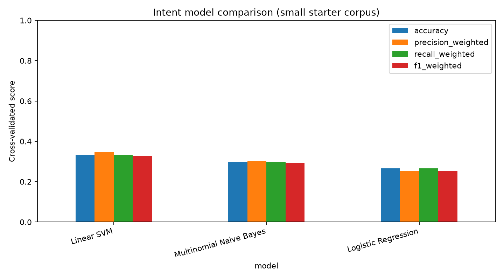
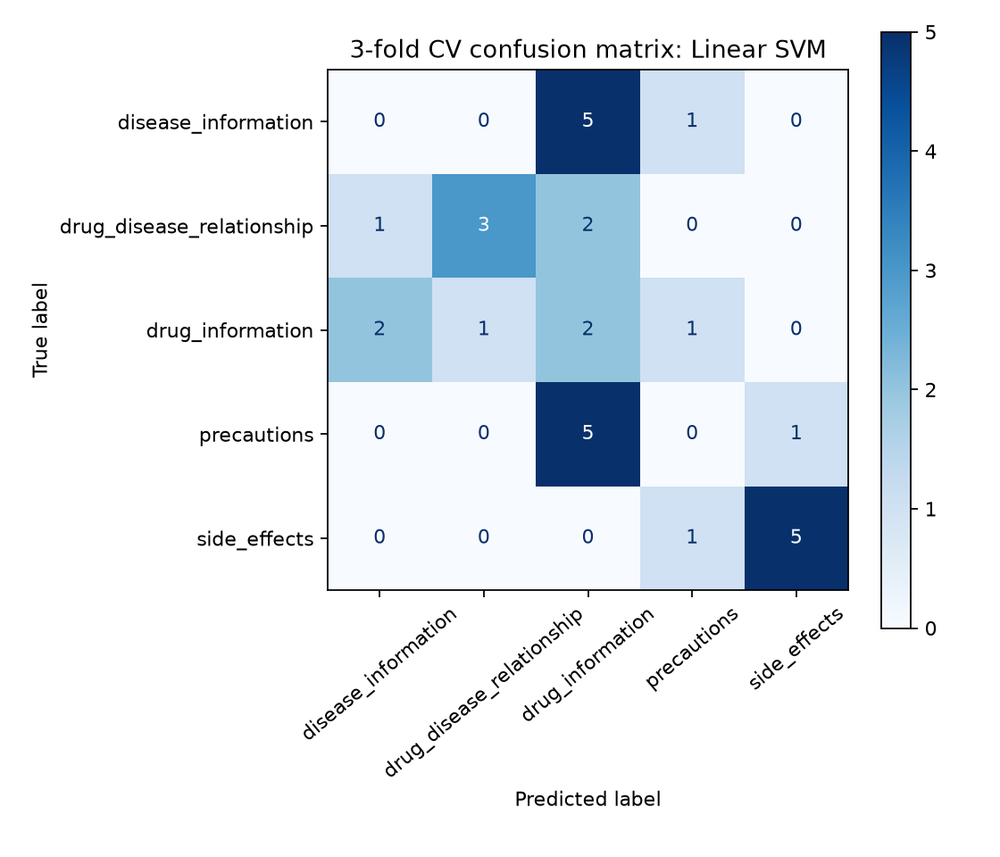
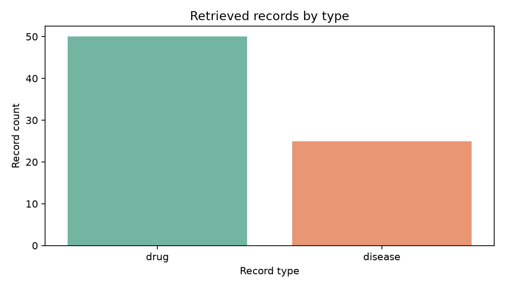

# MediKnow AI — Project Report

## Abstract

MediKnow AI is a small educational prototype that maps natural-language queries to five information intents and retrieves source-linked records from a local SQLite database. Its pipeline combines TF-IDF text features and supervised classification with TF-IDF cosine similarity for retrieval. It uses a small live sample from FDA openFDA labeling and MedlinePlus health-topic search. It is not intended for clinical use.

## Problem and scope

Users often need approachable explanations of medicine labels and health topics. This prototype demonstrates intent classification, basic text retrieval, database preparation, evaluation and a Streamlit UI. It does not diagnose, prescribe, personalize risk, or cover all medicines and conditions.

## Dataset and preparation

The reproducible downloader requests up to ten openFDA labels for each of five generic ingredient queries. It retains source fields when present: generic/brand names and indication, adverse reaction, warning and precaution sections. The preparation script requests up to five MedlinePlus topic matches for each of five topic searches and stores the available title/snippet and source URL. Data is live API output; exact counts depend on API responses. Missing label sections are skipped. MedlinePlus URLs are deduplicated. Source names, URLs and ingestion timestamps are stored in SQLite.

Licensing is mixed: openFDA warns some submitted label content may carry third-party copyright; MedlinePlus pages also have mixed rights. This project preserves citations and links; consult the respective terms before redistribution.

## Method

The supervised component uses a transparent 30-example starter corpus (six examples per intent). Text is lowercased, Unicode accents stripped, and encoded with TF-IDF word unigrams and bigrams; stopword removal is not applied to the classifier because question words can convey intent. A stratified three-fold CV with fixed seed generates out-of-fold predictions for Logistic Regression, Multinomial Naive Bayes, and Linear SVM. Accuracy and weighted precision, recall and F1 are reported, along with class reports and the selected model's confusion matrix. The best weighted-F1 candidate is fit on the full starter set for the app.

For retrieval, the app computes TF-IDF cosine similarity between a query and source record title/text. Intent can constrain the lookup to drug or disease records. Side-effect, precaution and indication intents further filter for the matching section. A no-hit or missing-section response avoids making a claim from absent data.

## Results

The run produced 50 FDA label records and 25 MedlinePlus topic records (75 total; the topic searches may overlap, and the FDA API may return multiple product labels for the same ingredient). The raw files, SQLite knowledge base and data summary are included. These counts describe only this API sample, not disease or drug prevalence.

Three-fold stratified CV over the 30 hand-authored intent examples produced:

| Model | Accuracy | Weighted precision | Weighted recall | Weighted F1 |
|---|---:|---:|---:|---:|
| Linear SVM | 0.333 | 0.345 | 0.333 | 0.327 |
| Multinomial Naive Bayes | 0.300 | 0.303 | 0.300 | 0.295 |
| Logistic Regression | 0.267 | 0.253 | 0.267 | 0.255 |

Linear SVM was selected by weighted F1 and fitted to all 30 examples for the application. The scores are low and the set is tiny, making clear that this is a pipeline demonstration rather than a useful or validated intent model. Generated outputs include the per-class classification report and confusion matrix under `reports/` and `reports/figures/`.

### Evaluation figures

## Limitations and future work

The sample and intent corpus are small; API query results are not exhaustive; keyword-level similarity can retrieve a misleading passage; the record parser should be checked against real API responses; and the prototype has no clinical validation. Future work: collect and annotate diverse paraphrases, evaluate with a held-out user-like dataset, expand coverage through source APIs, review licensing, test retrieval relevance, and add explicit human review for safety-sensitive categories.

## Architecture

See `ARCHITECTURE.md` and `DATA_FLOW.md` for diagrams. Run steps and exact output paths are in the top-level README.
